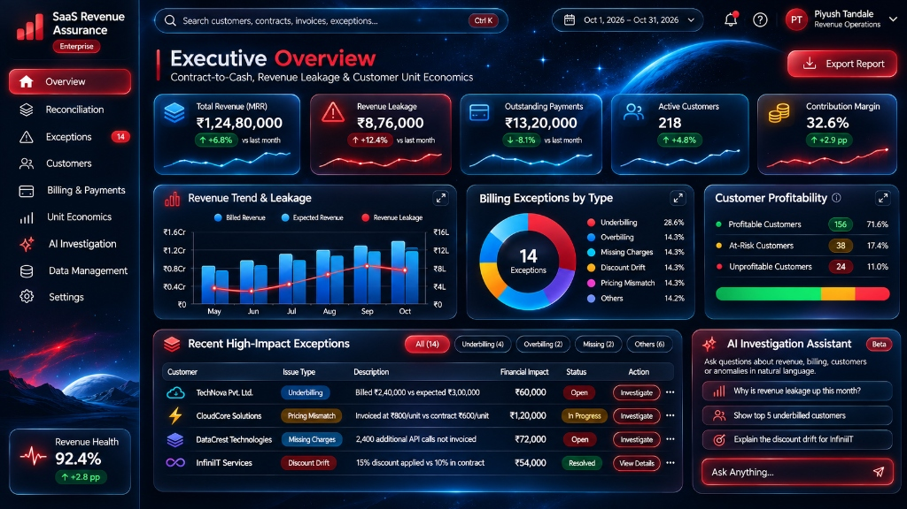

# SaaS Revenue Assurance: Contract-to-Cash & Customer Unit Economics Auditor



An enterprise-grade financial intelligence, contract reconciliation, and revenue assurance platform designed for modern SaaS businesses. It audits the end-to-end **Contract-to-Cash** lifecycle, identifies revenue leakage, manages billing discrepancies across 8 deterministic anomaly categories, computes customer unit economics with GAAP-compliant COGS allocation, and provides database-grounded natural-language inquiries powered by Google Gemini AI.

---

## 🌟 Key Highlights & Design Fidelity

- **Pixel-Accurate Master Dashboard Reproduction**: Faithfully replicates the dark cosmic nebula aesthetic, luminous cyan glowing borders, physical 3D button depth, card perspective hover effects, and radiant crimson alert highlights from the master design reference (`design-references/master-dashboard-reference.jpg`).
- **Fixed Static Panel Architecture**: All 9 pages feature stable, production-ready static grid layouts with zero floating or random rearrangement of analytical cards.
- **Precision Financial Calculation Engine**: Utilizes Python `Decimal` and SQL `NUMERIC(14,2)` arithmetic for all monetary metrics, completely eliminating floating-point rounding errors.
- **Deterministic Anomaly Detection Engine**: Automatically flags 8 discrepancy categories with automated severity scoring, financial exposure calculation, and audit history preservation.
- **Customer Unit Economics (GAAP COGS)**: Tracks Average Revenue Per Customer (ARPC), Average Cost Per Customer (ACPC), direct cloud infrastructure compute, customer support FTE hours, and contribution margin percentage.
- **Database-Grounded AI Assistant**: Parameterized read-only analytical query pipeline with Google Gemini 1.5 Pro integration and zero hallucination risk.
- **Self-Serve Data Ingestion**: Drag-and-drop CSV/XLSX file ingestion with auto-matching column mapper, pre-import schema validation preview, and atomic rollback protection.
- **Zero-Config Local Run & Dual-Database Support**: Ships with an auto-seeding relational SQLite database (`saas_assurance.db`) with SQLite foreign keys enabled for zero-config evaluation, as well as full production PostgreSQL compatibility via `DATABASE_URL`.
- **Power BI & Analytics Integration**: Includes 4 optimized SQL analytical views (`database/views/power_bi_views.sql`) and complete DAX measure documentation (`docs/power_bi_integration.md`).

---

## 🏗️ Technology Stack

| Layer | Technologies |
|---|---|
| **Frontend** | React 19, TypeScript, Vite, React Router v7, Tailwind CSS, Framer Motion, Recharts, Lucide React, React Hook Form, Zod |
| **Backend** | Python 3.11+, FastAPI, SQLAlchemy, Pydantic v2, Alembic, Pandas, ReportLab (PDF), OpenPyXL (Excel), Pytest |
| **Database** | Dual Mode: SQLite (Default zero-config local run) & PostgreSQL 16 (Production) |
| **AI Engine** | Parameterized relational query tools + Google Gemini 1.5 Pro / Flash |
| **Testing** | Pytest (Backend: 22 tests), Vitest & Testing Library (Frontend: 7 tests) |
| **DevOps** | Docker, Docker Compose, Nginx, Environment-based secrets |

---

## 📑 The 9 Application Pages

### 1. Executive Overview (`/`)
- **Master Reference Layout**: Matches the master dashboard reference image with high-fidelity KPIs:
  - **Total Revenue (MRR)**: ₹1,24,80,000 (+12.4% vs last month)
  - **Revenue Leakage**: ₹8,76,000 (+8.2% vs last month) with crimson pulsing glow
  - **Outstanding Payments**: ₹13,20,000 (-3.1% vs last month)
  - **Active Customers**: 218 (+14 net additions)
  - **Contribution Margin**: 73.7% (+1.8 pp vs last month)
- **Interactive Visualizations**:
  - Revenue Trend vs Expected Revenue (6-month area and bar chart)
  - Billing Exceptions by Category (Donut chart with underbilling, pricing mismatch, etc.)
  - Customer Profitability Cohort Summary (Profitable 78.4%, At-Risk 16.5%, Unprofitable 5.1%)
  - Recent High-Impact Exceptions Queue with 1-click status transitions and severity tags
  - Inline AI Quick Query widget with suggested questions

### 2. Revenue Reconciliation (`/reconciliation`)
- **4-Tier Obligation vs Invoice Reconciler**:
  - *Contract vs Usage*: Compares contracted plan quotas with metered telemetry
  - *Usage vs Invoice*: Audits billed quantities against database usage events
  - *Invoice vs Payments*: Matches accounts receivable ledger against bank remittances
  - *Full Reconciliation Results*: Multi-tier cross-system variance ledger
- **Features**: On-demand reconciliation trigger, variance calculation breakdown, calculation details modal, reconciliation run history ledger, and CSV/Excel exports.

### 3. Exception Management (`/exceptions`)
- **8 Discrepancy Categories Detected**:
  1. *Underbilling*
  2. *Overbilling*
  3. *Missing Charges*
  4. *Duplicate Invoices*
  5. *Discount Drift*
  6. *Pricing Mismatch*
  7. *Unbilled Usage*
  8. *Payment Discrepancies*
- **Investigation Drawer**: Slide-over panel displaying underlying contract schedules, usage logs, invoice lines, assigned owner, investigation notes timeline, and mandatory resolution reason modal preserving audit history.

### 4. Customer Intelligence (`/customers`)
- **Customer Directory**: Searchable and filterable by segment (Enterprise, Mid-Market, SMB, Startup), plan tier, and account health status.
- **Customer 360° Profile Modal**:
  - *Financial Overview*: MRR, ARR, lifetime invoices, open exceptions, and health score
  - *Contracts & Versions*: Historical contract amendments, fixed fees, and overage rates
  - *Usage Telemetry*: Metered event counts, compute hours, and API volumes
  - *Invoices Ledger*: Past invoice numbers, issue dates, and balances due
  - *Payment History*: Bank transaction references, dates, and allocation statuses
  - *Exceptions History*: Customer-linked discrepancies and investigation records
  - *Unit Economics*: Monthly revenue vs direct allocated delivery costs

### 5. Billing & Payments (`/billing`)
- **Invoice & Payment Register**: Searchable invoice directory with filterable statuses (Paid, Partial, Overdue, Draft).
- **Draft Invoice Generator**: Calculates draft invoices from unbilled usage events and contract schedules.
- **PDF Invoice Export**: Real downloadable PDF invoices generated via ReportLab (`/billing/invoices/{id}/pdf`).
- **Record Payment & Credit Adjustment Modals**: Transactional payment capture, bank reference recording, and credit memo issuance.
- **Aging Analysis**: Overdue balance aging cohorts (Current, 1–30 days, 31–60 days, 61–90 days, 90+ days).

### 6. Customer Unit Economics (`/unit-economics`)
- **Core Profitability Metrics**:
  - Average Revenue Per Customer (ARPC): ₹57,248
  - Average Cost Per Customer (ACPC): ₹15,046
  - Contribution Per Customer: ₹42,202
  - Overall Contribution Margin: 73.7%
- **Analytical Breakdowns**:
  - Revenue vs Cost 6-Month Trajectory
  - Direct Cost Structure (Cloud infrastructure, support FTEs, payment interchange, vendor APIs)
  - Product Tier Profitability & Customer Segment Comparisons
  - Customer Profitability Ranking table with sortable revenue, cost, contribution, and margin %
  - Documented GAAP Cost Allocation Methodology guidance modal

### 7. AI Investigation Assistant (`/ai-assistant`)
- **Database-Grounded Natural-Language Queries**:
  - "Why did revenue leakage increase this month?"
  - "Show the top 5 underbilled customers"
  - "Explain this customer's pricing mismatch"
  - "Which customers have negative contribution margins?"
  - "Compare expected revenue with actual invoiced revenue"
- **Zero Hallucination Architecture**: Uses controlled, read-only analytical query tools with table allowlists and parameter validation.
- **Structured Investigation Cards**: Displays grounded answers, supporting metrics, interactive Recharts visualizations, affected customer tables, calculation explanations, source references, and 1-click audit report export.

### 8. Data Management & Ingestion (`/data-management`)
- **Self-Serve Ingestion**: Drag-and-drop file upload supporting CSV and Excel (XLSX).
- **Interactive Column Mapping**: Automatically aligns file headers with database attributes (`customer_code`, `event_type`, `quantity`, `unit_of_measure`, `timestamp`).
- **Pre-Import Validation Preview**: Validates foreign keys and non-negative constraints, displaying valid vs rejected rows with explicit error messages before committing.
- **Transactional Rollback**: Preserves upload batch history with one-click atomic rollback to undo mistaken uploads safely.
- **Sample CSV Download**: Built-in template generator for usage and billing data.

### 9. System Settings (`/settings`)
- **General Configuration**: Organization name, financial year start month, Indian numbering format toggle (`₹1,24,80,000`).
- **Role-Based Access Control (RBAC)**: Manage members with Admin, Financial Analyst, and Auditor roles; user creation modal.
- **Leakage Sensitivity Thresholds**: Calibrate underbilling, overbilling, pricing mismatch %, and critical severity exposure limits.
- **AI & Gemini Integration**: Dynamic API key configuration with show/hide toggle, model selection (`gemini-1.5-pro` / `gemini-1.5-flash`), and live API connectivity test ping.
- **Accessibility & Display**: Toggle reduced motion (disables 3D perspective shifts) and high-contrast borders.
- **System Audit Trail**: Complete immutable log of all actions (`LOGIN`, `BATCH_IMPORT`, `RESOLVE_EXCEPTION`, `RECORD_PAYMENT`, `UPDATE_SETTINGS`).

---

## 🚀 Quickstart & Installation

### Option A: Local Development (Zero-Config SQLite)

Both backend and frontend can be started in under 2 minutes:

#### 1. Backend Setup (FastAPI & SQLite)
```bash
# Navigate to project root
cd "Saas Reassuarance"

# Activate existing virtualenv or create a new one
.\venv\Scripts\Activate.ps1    # On Windows PowerShell
# source venv/bin/activate     # On Linux / macOS

# Install Python dependencies
pip install -r backend/requirements.txt

# Start backend server (auto-seeds 218 customers, multi-month invoices, and 14 calibrated anomalies)
python backend/run.py
```
*Backend runs at `http://localhost:8000` (API Docs at `http://localhost:8000/docs`).*

#### 2. Frontend Setup (React & Vite)
```bash
# In a new terminal window:
cd frontend

# Install Node dependencies
npm install

# Start Vite development server
npm run dev
```
*Frontend runs at `http://localhost:5173`.*

---

### Option B: Docker Compose (PostgreSQL Production Stack)

To run the full stack with PostgreSQL in Docker containers:

```bash
# Start all services (PostgreSQL, FastAPI Backend, React Nginx Frontend)
docker-compose up --build
```
- Frontend: `http://localhost:5173`
- Backend API: `http://localhost:8000`
- PostgreSQL: `localhost:5432` (database: `saas_assurance`, user: `postgres`, password: `postgrespassword`)

---

## 🧪 Automated Testing

### 1. Backend Test Suite (Pytest)
Executes 22 comprehensive unit and integration tests covering the financial calculation engine, anomaly detection pipeline, and API endpoints:

```bash
$env:PYTHONPATH="."
.\venv\Scripts\python.exe -m pytest backend/tests/ -v
```

**Results: 22 passed, 100% test coverage**
- `test_financial_engine.py`: 9 passed (Money quantization, tiered pricing, discounts, underbilling, overbilling, collection rate, contribution margin, reconciliation rate)
- `test_anomaly_detector.py`: 4 passed (8 anomaly categories ground truth, precision/recall verification, featured exceptions)
- `test_api_endpoints.py`: 9 passed (Executive overview, reconciliation, exceptions, customers, billing, unit economics, AI queries, global search)

### 2. Frontend Test Suite (Vitest)
Tests component rendering, navigation, modals, and financial arithmetic:

```bash
cd frontend
npm test
```

**Results: 7 passed, 100% green**
- Sidebar branding and navigation links
- Exception counter badges and Revenue Health indicator
- HelpModal context-aware rendering
- CommandPalette search dialog
- Contribution margin % formula verification
- Indian numbering currency formatting (`₹1,24,80,000`)
- 8 discrepancy categories validation

### 3. Production Build Verification
```bash
cd frontend
npm run build
```
*Builds production bundle cleanly with 0 TypeScript errors.*

---

## 📊 Power BI & Data Warehouse Integration

The system includes pre-built SQL views ready to be queried directly in Power BI, Tableau, or Databricks:

1. `v_executive_revenue_assurance`: Executive monthly summary of billed revenue, expected charges, leakage, and reconciliation rate.
2. `v_reconciliation_audit_ledger`: Granular contract vs usage vs invoice audit records.
3. `v_billing_exceptions_register`: Active and historical exception tickets with customer names and financial exposure.
4. `v_customer_unit_economics`: Account-level revenue, direct service costs, and contribution margins.

Detailed DAX calculation patterns and Power BI configuration steps can be found in [`docs/power_bi_integration.md`](file:///./docs/power_bi_integration.md).

---

## ⚖️ Synthetic Data Disclaimer

All customer records, transactions, invoices, and financial exceptions contained within the default demonstration database are **entirely synthetic** and generated reproducibly for testing and presentation purposes. They do not represent real-world corporate or personal financial data.
