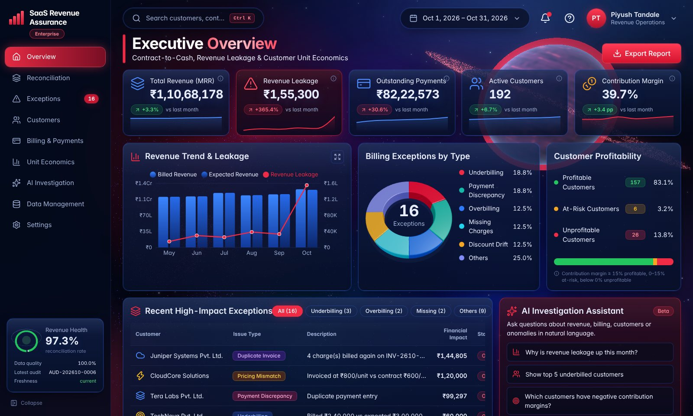
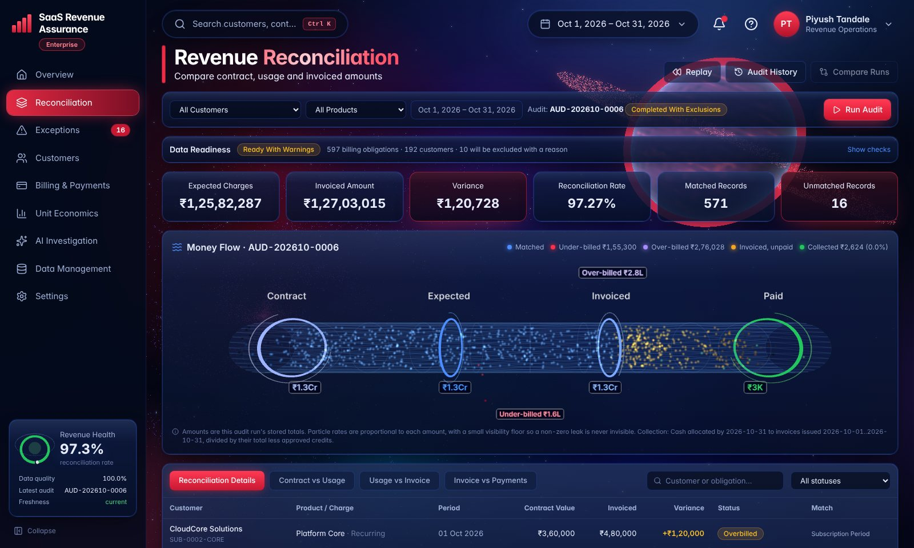
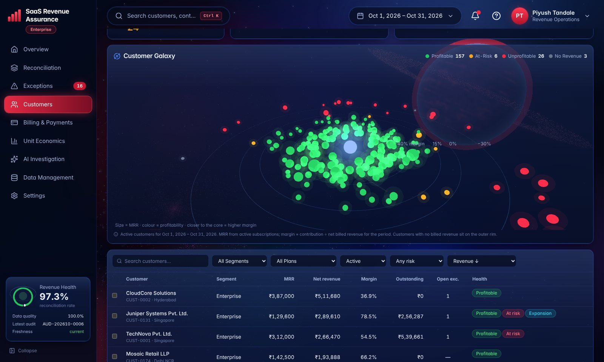
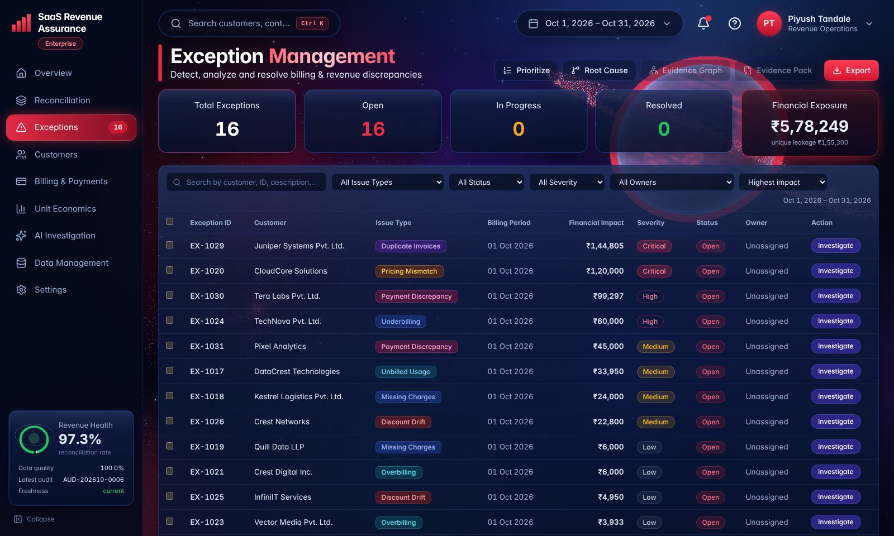
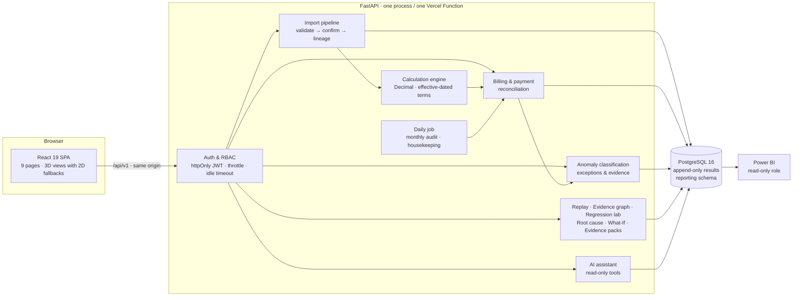

<div align="center">


# SaaS Revenue Leakage Auditor

**Contract-to-Cash & Customer Unit Economics Auditor**

Finds the revenue a SaaS business earned but never billed, or billed but never collected,<br/>and proves every number with the records behind it.

<br/>

[](https://saas-revenue-leakage-auditor.vercel.app)
[](https://github.com/piyushT3003/SaaS-Revenue-Leakage-Auditor/actions/workflows/ci.yml)
[](LICENSE)


[**Live demo**](https://saas-revenue-leakage-auditor.vercel.app) · [Features](#-features) · [Architecture](#-architecture) · [Quick start](#-quick-start) · [Quality](#-quality--testing) · [Docs](#-documentation)

<br/>



<sub>The live demo opens straight into a read-only workspace with **synthetic** data. No sign-up needed.</sub>

</div>

---

## 💡 The problem

SaaS revenue leaks quietly. A discount that should have expired keeps getting applied. A price increase never reaches the invoice. Usage above the allowance goes unbilled. A payment is recorded twice. Each case is small, but across hundreds of contracts they add up, and finance teams usually find them by accident.

## ✅ What this does

1. **Rebuilds what should have been billed.** It works from each customer's contract versions, pricing rules, discounts, allowances and usage, using exact decimal arithmetic.
2. **Reconciles that against what was invoiced and paid.** Billing and payment reconciliation run as separate engines, and ambiguous matches go to review instead of being guessed.
3. **Classifies every discrepancy into 8 anomaly types**, each with evidence, severity, an owner and a workflow. The same money is never counted twice.
4. **Explains it.** Each exception can be traced from contract to rule to obligation to invoice. Root-cause clusters, prioritisation scores and an AI assistant that only reads data help you investigate.
5. **Measures what each customer is actually worth.** Contribution margin by customer, product and segment, with a What-If simulator.

> On the synthetic dataset, detection reaches **precision = recall = 1.0** across all 8 anomaly categories against 34 planted ground-truth cases. A monthly audit over 200 customers completes in about **1 second**.

## 🖼️ Screenshots

<table>
  <tr>
    <td width="50%"><br/><b>Reconciliation</b>: money flows contract → expected → invoiced → paid; under-billing drips out in red.</td>
    <td width="50%"><br/><b>Customer galaxy</b>: every customer is a star. Size = MRR, colour = profitability, distance = margin.</td>
  </tr>
  <tr>
    <td width="50%"><br/><b>Exceptions</b>: prioritised findings with impact, severity, owners, root cause and evidence packs.</td>
    <td width="50%"><br/><b>AI investigation</b>: answers come only from approved read-only queries, and each shows how it was calculated.</td>
  </tr>
</table>

## ✨ Features

<table>
<tr><td valign="top" width="50%">

#### 📥 Data onboarding
- 14 datasets (CSV / XLSX), with downloadable templates
- Column auto-detection, mapping, type and reference validation
- Duplicate detection, **confirm before storing**, rollback
- Row-level lineage on every record

#### 🧮 Financial engine
- Effective-dated contract and pricing-rule versions, plus proration
- Per-unit, flat, graduated and volume tiers
- Allowances, discounts and minimum commitments
- `Decimal` arithmetic everywhere, with no floating-point money

#### 🔍 Reconciliation & anomalies
- Obligation-level billing match and independent payment reconciliation
- Underbilling, overbilling, missing charges, duplicate invoices, discount drift, pricing mismatch, unbilled usage, payment discrepancies
- Immutable, idempotent audit runs, with run-to-run comparison

</td><td valign="top" width="50%">

#### 🕵️ Investigation
- Exception workflow: assign, notes, status, segregation of duties
- **Revenue Evidence Graph** (2D and interactive 3D)
- Root-cause clusters and transparent 0–100 priority scores
- Tamper-evident evidence packs (PDF/XLSX + SHA-256)

#### 🧪 Advanced assurance
- **Historical Replay**: an audit as the data was known at the time
- **Billing Rules Regression Lab**: propose → test → second-admin approval → dated activation
- **Usage Meter Integrity**: control totals and sequence gaps
- **What-If Simulator**: always labelled hypothetical, never changes data

#### 🤖 AI assistant
- 9 approved, read-only, tenant-scoped tools; never writes SQL
- Refuses to change data, and shows the calculation behind each answer
- Works without an API key; LLM planning is optional

</td></tr>
</table>

**Also included**
- **Analytics:** a Power BI-ready `reporting` schema with a read-only role, DAX measures and Power Query files ([analytics/](analytics/README.md)).
- **Interface:** a WebGL interface with a 2D fallback for every 3D view, honouring reduced motion.
- **Accounts:** password reset, idle sign-out, demo mode and a first-run **Get started** guide.
- **Privacy:** company data export and a guarded erase.

## 🏗️ Architecture



| Layer | Technology |
|---|---|
| **Backend** | Python 3.13 · FastAPI · SQLAlchemy 2 · Alembic · Pydantic 2 · pandas · ReportLab · openpyxl |
| **Database** | PostgreSQL 16: `NUMERIC` money, trigger-enforced immutability, `reporting` schema |
| **Frontend** | React 19 · TypeScript · Vite · Tailwind CSS · TanStack Query · Framer Motion · Recharts |
| **3D** | Three.js · React Three Fiber · drei, all lazy-loaded with 2D fallbacks |
| **Analytics** | Power BI (DAX, Power Query) · SQL · Jupyter |
| **Quality** | pytest · Vitest · Playwright · axe-core (WCAG 2.1 AA) · pip-audit · npm audit |
| **Platform** | Vercel (Singapore) · Neon Postgres · GitHub Actions · Dependabot · Docker Compose |

## 🚀 Quick start

**Windows, one click:** double-click **`START_APP.bat`**, then open **http://localhost:5185** and sign in as `piyush@demo.local` / `Demo-Pass-2026`. The launcher:
- uses Docker if it's running, or else a local or auto-installed PostgreSQL;
- installs the dependencies;
- loads the synthetic demo;
- runs the six demo audits.

<details>
<summary><b>Docker</b></summary>

```bash
cp .env.example .env          # set JWT_SECRET (32+ chars), POSTGRES_PASSWORD, BOOTSTRAP_ADMIN_EMAIL
docker compose up --build
docker compose exec backend python -m backend.app.seed.cli --demo-password "<choose one>" --run-audits
```
- **App:** http://localhost:5185
- **API docs:** http://localhost:8085/docs
</details>

<details>
<summary><b>Manual (Python 3.11+, Node 20+, PostgreSQL 16)</b></summary>

```bash
cp .env.example .env
python -m venv venv && source venv/bin/activate      # Windows: .\venv\Scripts\Activate.ps1
pip install -r backend/requirements-dev.txt
uvicorn backend.app.main:app --port 8085 --reload     # terminal 1
cd frontend && npm install && npx vite --port 5185    # terminal 2
python -m backend.app.seed.cli --demo-password "<choose one>" --run-audits   # demo users + audits
```
</details>

<details>
<summary><b>VS Code</b></summary>

1. Run **`SETUP_VSCODE.bat`** once.
2. Run the task **Setup: install dependencies**.
3. From then on, run the task **▶ Start app**. It starts a private PostgreSQL on port 5433, the API with auto-reload and the web app.

**Run and Debug → Full stack (debug)** gives you breakpoints in the API.
</details>

<details>
<summary><b>Deploy to Vercel + Neon (free tiers)</b></summary>

`vercel.json` and `pyproject.toml` are included. The FastAPI backend runs as one Vercel Function, and the built frontend is served from the CDN. Step-by-step guide: [`docs/deployment/VERCEL.md`](docs/deployment/VERCEL.md).
</details>

## 🧪 Quality & testing

| Suite | Result | What it proves |
|---|---|---|
| **Backend** (pytest, dedicated DB) | **108 passed** | All 15 specification financial tests, ground-truth precision/recall, replay reproducibility, approval separation of duties, simulation isolation, AI guardrails, security headers, data rights, scheduling |
| **Browser E2E** (Playwright) | **29 passed** | Full workflow: upload → validate → import → audit → investigate → correct → re-audit → compare → export |
| **Accessibility** (axe-core) | **10 / 10 pages** | No serious or critical WCAG 2.1 A/AA violations |
| **Frontend unit** (Vitest) | **5 passed** | Component behaviour |
| **Dependencies** | **0 known vulnerabilities** | pip-audit and npm audit, plus weekly Dependabot updates |

Every push runs the backend tests, the frontend type check and build, the dependency audit and the browser E2E suite on GitHub Actions.

## 🔐 Security & operations

- **Accounts:**
  - bcrypt password hashing;
  - JWT in an httpOnly `SameSite=Strict` cookie with server-side revocation;
  - idle sign-out;
  - a login throttle shared through the database.
- **Integrity:**
  - permissions enforced on the server for each role (admin / analyst / viewer);
  - append-only audit results, enforced by database triggers;
  - corrections void and reissue the record, never edit it.
- **Web hardening:** strict CSP with no third-party origins, clickjacking and MIME protections, and spreadsheet formula-injection guards.
- **Operations:**
  - encrypted weekly backups with a [tested restore](docs/operations/BACKUP_AND_RESTORE.md);
  - a daily scheduled audit;
  - optional Sentry error monitoring and email alerts.

See [`SECURITY.md`](SECURITY.md) and the [security review](docs/security/SECURITY_REVIEW.md).

## 📁 Project structure

```
├── backend/app/         FastAPI application
│   ├── analytics/       calculation engine & metrics
│   ├── reconciliation/  audit runner, matching, payment reconciliation
│   ├── anomaly_detection/  8-category classifier
│   ├── replay/ · evidence_graph/ · regression/ · root_cause/ · simulation/ · usage_integrity/
│   ├── ai/              read-only assistant tools & engine
│   ├── ingestion/       14 dataset specs, validation, lineage
│   └── api/             REST endpoints (/api/v1)
├── backend/migrations/  Alembic migrations (0001–0007)
├── backend/tests/       pytest suite
├── frontend/src/        React app (pages, 3D components, design system)
├── frontend/e2e/        Playwright + accessibility tests
├── analytics/           Power BI model, DAX, Power Query, SQL, notebooks
└── docs/                specification, report, deployment, operations, security
```

## 📚 Documentation

| Document | Contents |
|---|---|
| [Implementation report](docs/IMPLEMENTATION_REPORT.md) | Modules, schema, APIs, test evidence, limitations |
| [Business workflows](docs/workflows/WORKFLOWS.md) | Onboard → audit → investigate → correct → verify |
| [Product specification](docs/PRODUCT_MASTER_SPECIFICATION.md) | The full product specification |
| [Deployment guide](docs/deployment/VERCEL.md) | Vercel + Neon, environment variables, verification |
| [Backup & restore](docs/operations/BACKUP_AND_RESTORE.md) | Encrypted backups and the tested restore procedure |
| [Performance, accessibility, recovery](docs/testing/PERFORMANCE_ACCESSIBILITY_RECOVERY.md) | Measured results |
| [Changelog](CHANGELOG.md) | Release notes |

## ⚠️ Known limitations

- **Power BI file:** no `.pbix` is included. The model, measures and a build guide are provided, but the report has not been tested in Power BI Desktop.
- **Data sources:** data enters by file import only. There are no live connectors to billing, payment or banking systems.
- **Scope:** one currency and one company per deployment. Contracts in other currencies are excluded from audits, with the reason shown.
- **AI assistant:** the optional language-model mode has only been tested against a scripted provider.
- **Not yet done:** an external penetration test, load testing of the hosted deployment, and two-factor authentication.

## 📄 License & data notice

Released under the [MIT License](LICENSE) © 2026 **Piyush Tandale**.

All customers, contracts, invoices, payments and anomalies in the demo are **synthetic**. Results computed from them describe no real company and are not real savings.
