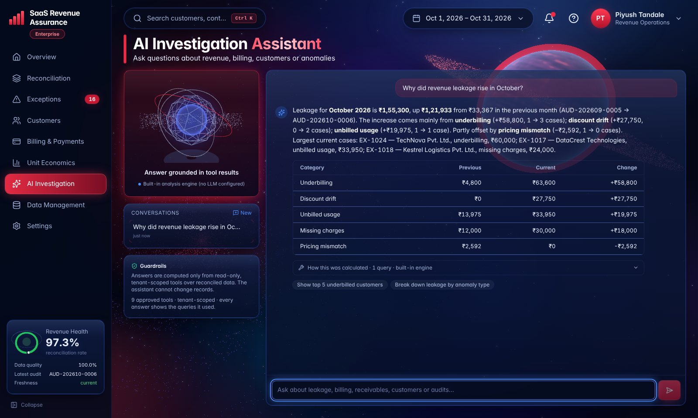
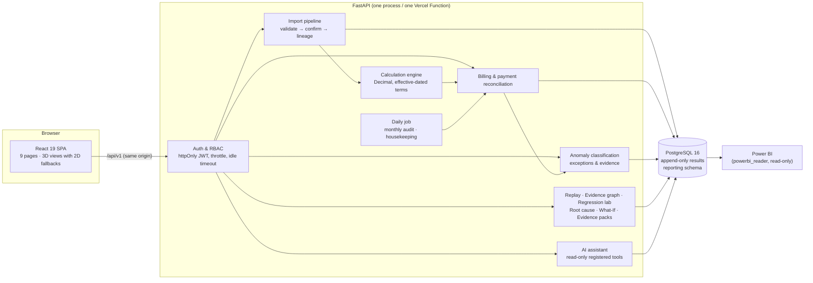

# SaaS Revenue Assurance
### Contract-to-Cash & Customer Unit Economics Auditor

[](https://github.com/piyushT3003/SaaS-Revenue-Leakage-Auditor/actions/workflows/ci.yml)
   

An independent revenue-integrity and financial-analytics platform for SaaS businesses. From each customer's contracts, pricing rules and usage it works out what that customer should have been billed. It then reconciles this against invoices and payments, detects revenue leakage and other discrepancies, and measures customer and product profitability. Every figure is traceable to the stored records it came from.

> **Status: v1.0.0.** All 14 specification phases and the production-hardening work are implemented and tested (see [Tests](#tests)). Production readiness is claimed only for what is evidenced in [`docs/IMPLEMENTATION_REPORT.md`](docs/IMPLEMENTATION_REPORT.md); remaining limitations are listed under [Known limitations](#known-limitations).
> Specification: [`docs/PRODUCT_MASTER_SPECIFICATION.md`](docs/PRODUCT_MASTER_SPECIFICATION.md) · Changelog: [`CHANGELOG.md`](CHANGELOG.md)

| | |
|---|---|
|  |  |
| **Executive overview**: audited KPIs with formulas on the back of each card, 3D exception donut | **Reconciliation**: contract → expected → invoiced → paid, with leaks drawn from the stored audit |
|  |  |
| **Customer galaxy**: size = MRR, colour = profitability, distance = margin | **AI investigation**: answers only from approved read-only queries, with the calculation shown |

All screenshots show the synthetic demo dataset.

## Architecture



## What it does

| Area | Capability |
|---|---|
| **Data onboarding** | 14 datasets (CSV/XLSX), with:<ul><li>auto-detection and column mapping</li><li>type, enum and reference validation</li><li>duplicate detection</li><li>explicit confirmation before import</li><li>lineage on every record</li><li>safe rollback</li></ul> |
| **Financial engine** | <ul><li>Contract and pricing-rule versioning, proration and mid-period amendments</li><li>Pricing models: per-unit, flat, graduated and volume tiers</li><li>Allowances, discounts and minimum commitments</li><li>Exact `Decimal` arithmetic throughout</li></ul> |
| **Reconciliation** | <ul><li>Obligation-level billing match; ambiguous matches go to review and are never guessed</li><li>Independent payment reconciliation and ageing</li><li>Immutable, idempotent audit runs with run comparison</li></ul> |
| **Anomaly detection** | 8 categories:<ul><li>underbilling and overbilling</li><li>missing charges and duplicate invoices</li><li>discount drift and pricing mismatches</li><li>unbilled usage and payment discrepancies</li></ul>Each exception has an exposure key, so the same money is never counted twice as leakage |
| **Investigation** | <ul><li>Exception workflow: assign, notes, status, segregation of duties</li><li>Evidence Graph (2D and interactive 3D)</li><li>Root-cause clusters and transparent prioritization scores</li><li>Evidence packs (PDF/XLSX with a SHA-256 hash)</li></ul> |
| **Advanced** | <ul><li>Historical Replay (*as known at the time* / *with today's data*)</li><li>Billing Rules Regression Lab (propose → test → approval by a different admin → effective-dated activation)</li><li>Usage Meter Integrity monitor</li><li>What-If Simulator (always labelled hypothetical)</li></ul> |
| **AI Investigation Assistant** | <ul><li>Answers questions using 9 approved, read-only, tenant-scoped queries</li><li>Never writes SQL and refuses requests to change data</li><li>Shows "how this was calculated" for every answer</li><li>Works without an LLM key; optional Anthropic model planning</li></ul> |
| **Analytics / Power BI** | <ul><li>`reporting` schema (star schema views plus engine snapshots)</li><li>Read-only `powerbi_reader` role</li><li>DAX measure library, Power Query scripts and theme</li><li>Analytical SQL and executed notebooks; see [`analytics/`](analytics/README.md)</li></ul> |
| **Interface** | <ul><li>Nine pages: Overview, Reconciliation, Exceptions, Customers, Billing & Payments, Unit Economics, AI Investigation, Data Management, Settings</li><li>WebGL galaxy backdrop with a lit planet and bloom, a 3D revenue globe on sign-in, a 3D holographic AI core and a 3D evidence graph</li><li>Holographic panel rims and motion throughout</li><li>Falls back automatically to 2D when WebGL is unavailable or reduced motion is requested</li></ul> |
| **Accounts** | <ul><li>Change password (signs out other devices)</li><li>Forgot password by email (SMTP or Brevo) or admin-issued one-time reset links</li><li>Idle sign-out with a clear notice</li><li>Optional demo mode: visitors open a read-only demo without signing in (`DEMO_AUTO_LOGIN`), with a banner and a way to sign in</li><li>A **Get started** guide for an empty workspace</li></ul> |
| **Security** | <ul><li>bcrypt; JWT in an httpOnly `SameSite=Strict` cookie with server-side revocation</li><li>Login throttle shared through the database (works across serverless instances)</li><li>Role permissions enforced on the server</li><li>Append-only audit log and immutable results (DB triggers)</li><li>Security headers and CSP</li><li>Export formula-injection guard</li></ul>See [`docs/security/SECURITY_REVIEW.md`](docs/security/SECURITY_REVIEW.md) |

## Run it

### One click (Windows)
Double-click **`START_APP.bat`**. It uses Docker Desktop if it is running; otherwise it uses a local PostgreSQL 16 installation, your Python venv and Node. It generates `.env` secrets, loads the demo data, runs the six demo audits and serves the app at **http://localhost:5185**. Demo sign-in: `piyush@demo.local` / `Demo-Pass-2026`. Progress is logged to `start_app.log`.

### VS Code
Double-click **`SETUP_VSCODE.bat`** once. It copies the shared configuration from `tools/vscode/` into `.vscode/`. Then open the project folder in VS Code and accept the recommended extensions.
1. **First time:** `Ctrl+Shift+P` → **Tasks: Run Task** → **Setup: install dependencies**. This creates a Python 3.11+ `venv` and runs `npm install`.
2. **Every time:** **Tasks: Run Task** → **▶ Start app**. This:
   - starts a private PostgreSQL on `127.0.0.1:5433`; the binaries come from a system install or are added to `.pgenv` with conda on first use;
   - runs the API with auto-reload;
   - loads the demo users and runs the six demo audits once;
   - starts the web app.

   Then open **http://localhost:5185** and sign in as `piyush@demo.local` / `Demo-Pass-2026`.

**Debugging:** use **Run and Debug → Full stack (debug)** for breakpoints in the API plus the app in Edge, or **Pytest: current file**.

**Tests:** run **Tasks: Run Test Task** or use the Testing panel. Backend tests use the separate `sra_test` database.

### Docker
```powershell
copy .env.example .env      # set JWT_SECRET (32+ chars), POSTGRES_PASSWORD, BOOTSTRAP_ADMIN_EMAIL
docker compose up --build
docker compose exec backend python -m backend.app.seed.cli --demo-password "<choose one>" --run-audits
```
- **App:** http://localhost:5185
- **API docs:** http://localhost:8085/docs

On first start the backend applies migrations, creates the admin account and loads the synthetic demo dataset. If you left `BOOTSTRAP_ADMIN_PASSWORD` empty, the admin's one-time password is printed in the backend log.

### Local development (Windows, PowerShell)
Prerequisites: Python 3.11+, Node 20+, PostgreSQL 16.
```powershell
copy .env.example .env
python -m venv venv; .\venv\Scripts\Activate.ps1
pip install -r backend\requirements-dev.txt
uvicorn backend.app.main:app --port 8085 --reload        # terminal 1

cd frontend; npm install; npx vite --port 5185               # terminal 2 → http://localhost:5185
```
To create the optional demo users `piyush@demo.local` (Admin), `analyst@demo.local` and `viewer@demo.local`, run:
```powershell
python -m backend.app.seed.cli --demo-password "<choose one>" --run-audits
```

### Deploy (Vercel + Neon, free tiers)
See [`docs/deployment/VERCEL.md`](docs/deployment/VERCEL.md). The repository includes `vercel.json` and `pyproject.toml`; the backend runs as one Vercel Function and the built frontend is served from the CDN.

### Optional: language-model mode for the AI assistant
Set `LLM_PROVIDER=anthropic`, `LLM_API_KEY` and `LLM_MODEL` in `.env`. If these are not set, the assistant uses its built-in deterministic engine.

## Tests

| Suite | Command | Result (22 Nov 2026) |
|---|---|---|
| Backend (PostgreSQL `sra_test`, wiped each run) | `python -m pytest` | **108 passed** |
| Frontend unit | `cd frontend; npm test` | 5 passed |
| End-to-end, including the full spec workflow and WCAG 2.1 AA scans of every page (needs the running stack; adds records, so use a dev database) | `cd frontend; npx playwright install chromium; npm run e2e` | **29 passed** |

The backend suite covers:
- the financial tests from the specification
- precision and recall against the 34 planted ground-truth anomalies: 1.0 in every category
- replay reproducibility
- regression-lab segregation of duties
- simulation isolation, i.e. simulations never change stored data
- AI guardrails
- the reporting views reconciling to stored audits
- read-only enforcement for the Power BI role
- security headers

## Known limitations
- **No `.pbix` file is included.** Power BI Desktop was not available in the build environment. The model, measures, queries and a step-by-step build guide are in [`analytics/powerbi/`](analytics/powerbi/README.md).
- **LLM path not tested live.** The AI assistant's language-model path is tested only against a scripted fake provider; no live model was called.
- **No billing-system integrations.** There are no live connections to payment, bank or billing providers. Data enters through file imports.
- **One currency, one company per deployment.** Contracts in other currencies are excluded from audits with a reason; there is no self-service sign-up for other companies.
- **Not yet independently tested.** No external penetration test has been done, and no load test has been run against a hosted deployment.
- **No two-factor authentication.**

## Operations
- **Backups:** encrypted weekly backups and a tested restore procedure: [`docs/operations/BACKUP_AND_RESTORE.md`](docs/operations/BACKUP_AND_RESTORE.md).
- **Scheduled work:** a daily job audits the previous month once it has closed and prunes expired sign-in records (`/api/v1/cron/daily`, protected by `CRON_SECRET`).
- **Monitoring (optional):** Sentry error reporting for the API (`SENTRY_DSN`) and the browser (`SENTRY_FRONTEND_DSN`, sent through a same-origin tunnel); uptime checks against `/api/health/ready`.
- **Email (optional):** password-reset links and alerts for failed audits and new high-severity exceptions (`EMAIL_PROVIDER`).
- **Security:** see [`SECURITY.md`](SECURITY.md) and [`docs/security/SECURITY_REVIEW.md`](docs/security/SECURITY_REVIEW.md).

## License
[MIT](LICENSE) © 2026 Piyush Tandale.

## Synthetic data notice
All customers, contracts, invoices, payments and anomalies in the demonstration dataset are **synthetic**. Results computed from them do not describe any real company and are not real savings.
