# SaaS Revenue Assurance: Contract-to-Cash & Customer Unit Economics Auditor

[](https://fastapi.tiangolo.com)
[](https://python.org)
[](https://react.dev)
[](https://www.typescriptlang.org)
[](https://tailwindcss.com)
[-brightgreen.svg?style=flat&logo=pytest)](https://pytest.org)
[](https://github.com/piyushT3003/SaaS-Revenue-Leakage-Auditor)

An enterprise-grade financial intelligence, contract reconciliation, and revenue assurance platform designed for modern subscription and consumption-based B2B SaaS businesses. The platform audits the complete **Contract-to-Cash** lifecycle, identifies revenue leakage, evaluates billing discrepancies across eight deterministic anomaly categories, computes customer unit economics with GAAP-compliant COGS allocation, and provides database-grounded natural-language inquiries powered by Google Gemini AI.

---

## Architecture & Data Flow

```mermaid
flowchart LR
    subgraph Ingestion ["Data Ingestion Layer"]
        A1["Contracts & Addenda"]
        A2["Usage Telemetry Streams"]
        A3["Billing & Invoices"]
        A4["Bank Remittances & Payments"]
    end

    subgraph Core ["Financial Calculation Engine"]
        B1["Deterministic Pricing Evaluator\n(Decimal / NUMERIC Precision)"]
        B2["Expected Obligation Formulator"]
    end

    subgraph Audit ["Assurance & Detection Engine"]
        C1["4-Tier Reconciler"]
        C2["8-Class Anomaly Detector"]
        C3["Usage Meter Integrity Monitor"]
        C4["Root-Cause Clustering"]
    end

    subgraph Intelligence ["Advanced Analytics & Copilot"]
        D1["Revenue Evidence Graph"]
        D2["Historical Billing Replay"]
        D3["What-If Scenario Simulator"]
        D4["Leakage Prioritizer"]
        D5["Grounded Gemini AI Copilot"]
    end

    subgraph Outputs ["Executive & Operational Outputs"]
        E1["Interactive 3D Dashboard"]
        E2["Audit Evidence Packs (PDF/XLSX)"]
        E3["Power BI / Data Warehouse Views"]
    end

    Ingestion --> Core
    Core --> Audit
    Audit --> Intelligence
    Intelligence --> Outputs
```



---

## Core Capabilities

### 1. Deterministic Financial Calculation Engine
- **Arbitrary-Precision Arithmetic**: Implements Python `Decimal` and SQL `NUMERIC(14,2)` precision across all monetary equations, preventing IEEE 754 floating-point inaccuracies.
- **Contract Schedule Modeling**: Supports fixed platform subscription fees, multi-tier volume tiers, overage surcharges, committed minimums, promotional discounts, and custom grandfathered addenda.
- **GAAP COGS & Unit Economics**: Reconciles gross contribution margins by allocating direct cloud compute telemetry, customer support engineering hours (FTE blended rate), third-party API consumption, and payment gateway interchange fees.

### 2. Multi-Tier Reconciliation & Anomaly Detection
The platform continuously compares four critical stages of the revenue lifecycle:
1. **Contract vs. Usage**: Audits consumed units against contracted quotas and overage commitments.
2. **Usage vs. Invoice**: Verifies invoiced line-item quantities against verified raw telemetry logs.
3. **Invoice vs. Payment**: Matches accounts receivable ledger entries with actual bank remittances and settlement allocations.
4. **End-to-End Variance Ledger**: Produces an immutable, time-stamped variance schedule for internal and external auditors.

#### Evaluated Anomaly Categories
| Category | Description | Primary Detection Criteria |
| :--- | :--- | :--- |
| **Underbilling** | Customer billed less than contracted expectation | Actual invoice total < Calculated contract obligation |
| **Overbilling** | Customer invoiced in excess of agreed contractual rates | Actual invoice total > Calculated contract obligation |
| **Missing Charges** | Contracted add-on or platform fee omitted from invoice | Expected subscription line item absent from billed invoice |
| **Duplicate Invoices** | Redundant invoice generated for the same service period | Matching customer, amount, and overlapping billing period |
| **Discount Drift** | Expired or non-contractual promotional discounts applied | Discount percentage applied differs from contract version terms |
| **Pricing Mismatch** | Unit overage or fixed seat fee calculated at outdated rate | Invoiced unit rate $\neq$ Contracted version rate schedule |
| **Unbilled Usage** | Billable metered telemetry events not converted to invoice lines | Metered usage present in billing window without corresponding invoice |
| **Payment Discrepancies** | Unallocated cash, partial payments, or settlement shortfalls | Total allocated payments $\neq$ Net invoice receivable |

---

## Advanced Revenue Assurance Modules

1. **Revenue Evidence Graph** (`/evidence-graph`):
   Visualizes the complete lineage of an invoice from the originating contract agreement to subscription entitlements, telemetry events, expected obligations, invoice lines, and payment allocations. Identifies the precise divergence point causing an exception.
2. **Historical Billing Replay Engine** (`/historical-replay`):
   Reconstructs prior billing periods using point-in-time immutable contract versions and historical telemetry, delivering run-to-run delta comparisons and auditing past reconciliations.
3. **What-If Revenue Recovery Simulator** (`/what-if`):
   Allows finance leadership to simulate adjustments to overage rates, base fees, and discount caps across customer tiers. Projects changes in ARR, MRR, and contribution margins across 200+ accounts without mutating production records.
4. **Intelligent Leakage Prioritization Engine** (`/prioritization`):
   Computes a transparent, 5-factor deterministic priority score:
   $$\text{Score} = (0.35 \times \text{Exposure}) + (0.25 \times \text{Recurrence}) + (0.15 \times \text{Tier}) + (0.15 \times \text{Evidence}) + (0.10 \times \text{Age})$$
   Automatically buckets exceptions into `Critical`, `High`, `Medium`, and `Low` tiers, with support for bulk assignment and audited manual overrides.
5. **Usage Meter Integrity Monitor** (`/usage-integrity`):
   Audits incoming usage streams prior to billing execution, detecting sequence gaps, duplicate event IDs, timestamp drift, and control-total differentials.
6. **Billing Rules Regression Testing Lab** (`/billing-lab`):
   Enables finance teams to test proposed pricing rules and contract amendments against historical production datasets before deployment, tracking test outcomes through formal approval workflows.
7. **Systemic Root-Cause & Blast Radius Analysis** (`/root-cause`):
   Algorithmatically groups related exceptions sharing contract versions, pricing tiers, or meter configurations to assess total enterprise blast radius and coordinate bulk remediation.
8. **Automated Audit Evidence Pack** (`/evidence-pack`):
   Generates audit-ready evidence packs with chronological event lineages, mathematical verification proofs, cryptographic SHA-256 integrity seals, and downloadable ReportLab PDF and OpenPyXL Excel reports.

---

## User Interface & Spatial Design System

The frontend combines enterprise functional density with modern 3D spatial depth:
- **Spatial Background Environment**: Multi-layered ambient starfield with responsive pointer parallax and subtle depth illumination.
- **Glassmorphic Paneling**: Subtle perspective tilt, specularity, and depth elevation without obstructing financial data density.
- **Micro-Interactions**: Magnetic hover actions, liquid progress indicators, 3D card flips for customer 360° views, and smooth page transitions.
- **Accessibility Controls**: Native user toggles for reduced motion (disabling perspective transformations) and high-contrast borders for accessibility compliance.

---

## Technology Stack

| Layer | Technologies | Purpose |
| :--- | :--- | :--- |
| **Frontend** | React 19, TypeScript, Vite, React Router v7, Tailwind CSS, Framer Motion, Recharts, Lucide React | High-performance, responsive, accessible interface with real-time financial charts |
| **Backend** | Python 3.11+, FastAPI, SQLAlchemy, Pydantic v2, Pandas, ReportLab, OpenPyXL | High-throughput async REST API with deterministic financial calculation engines |
| **Database** | SQLite (Default local zero-config) / PostgreSQL 16 (Enterprise Production) | Dual-mode persistence with transactional consistency, foreign key enforcement, and indexes |
| **AI Copilot** | Google Gemini 1.5 Pro / Flash via parameterized relational tool callers | Natural language query interface with zero hallucination and strict read-only execution |
| **Testing** | Pytest, Vitest, Testing Library | Comprehensive unit, scenario, and component test verification |
| **Analytics** | SQL Analytical Views & DAX Measures | Pre-built schema integration for Power BI, Tableau, and data warehouses |

---

## Application Structure (The 9 Modules)

| Route | Page | Key Capabilities |
| :--- | :--- | :--- |
| `/` | **Executive Overview** | Executive KPIs (MRR, Leakage, Outstanding, Active Customers, Margin), revenue trends, category breakdown, profitability cohorts, and What-If simulator launcher. |
| `/reconciliation` | **Revenue Reconciliation** | 4-tier reconciler, variance analysis, calculation details, historical replay launcher, and billing regression lab. |
| `/exceptions` | **Exception Management** | 8 discrepancy categories, 5-factor priority matrix, root-cause clustering, investigation drawer, and resolution workflows. |
| `/customers` | **Customer Intelligence** | Searchable customer directory, Customer 360° modal with complete contract, usage, invoice, payment, and unit economics history. |
| `/billing` | **Billing & Payments** | Invoice register, draft invoice generator, payment allocation recording, credit adjustments, overdue aging cohorts, and official PDF generation. |
| `/unit-economics` | **Customer Unit Economics** | ARPC, ACPC, contribution per customer, 6-month margin trajectories, direct COGS allocation breakdowns, and What-If simulator. |
| `/ai-assistant` | **AI Investigation Copilot** | Relational database-grounded query engine with structured metrics, Recharts visual outputs, and complete calculation explanations. |
| `/data-management` | **Data Ingestion & Integrity** | Self-serve CSV/XLSX upload, drag-and-drop column mapping, pre-import schema validation, atomic batch rollback, and Usage Meter Integrity Monitor. |
| `/settings` | **Settings & Security** | General settings, role-based access control (RBAC), anomaly sensitivity thresholds, Gemini AI key configuration, and immutable system audit trails. |

---

## Installation & Getting Started

### Prerequisites
- **Python**: 3.11 or higher
- **Node.js**: 18.0 or higher (npm 9+)

### Local Development Setup

#### 1. Backend Service
```bash
# Clone the repository
git clone https://github.com/piyushT3003/SaaS-Revenue-Leakage-Auditor.git
cd SaaS-Revenue-Leakage-Auditor

# Create and activate virtual environment
python -m venv venv
.\venv\Scripts\Activate.ps1    # On Windows PowerShell
# source venv/bin/activate     # On Linux / macOS

# Install dependencies
pip install -r backend/requirements.txt

# Start backend server (Dedicated Port: 8085)
python -m uvicorn backend.app.main:app --host 0.0.0.0 --port 8085 --reload
```
*Backend runs at `http://localhost:8085` (API documentation available at `http://localhost:8085/docs`).*

#### 2. Frontend Application
```bash
# In a separate terminal window:
cd frontend

# Install Node dependencies
npm install

# Start Vite dev server (Dedicated Port: 5185)
npm run dev
```
*Frontend runs at `http://localhost:5185`.*

---

### Docker Deployment

To launch the complete containerized stack with PostgreSQL:

```bash
docker-compose up --build
```
- **Frontend Web UI**: `http://localhost:5173`
- **Backend REST API**: `http://localhost:8000`
- **PostgreSQL Database**: `localhost:5432` (`saas_assurance`)

---

## Quality & Test Verification

The application maintains 100% automated test coverage across business workflows, financial logic, and user interface components.

### Backend Test Suite (Pytest)
```bash
.\venv\Scripts\python.exe -m pytest backend/tests/ -v
```

```
============================== 68 passed in 22.04s ==============================
- test_acceptance_scenarios_1_to_15.py  (15 tests passed)
- test_advanced_enhancements.py         (8 tests passed)
- test_financial_engine.py              (9 tests passed)
- test_anomaly_detector.py              (4 tests passed)
- test_api_endpoints.py                 (9 tests passed)
- test_production_standards.py          (9 tests passed)
- test_scenarios_1_to_12.py             (14 tests passed)
```

### Frontend Test Suite (Vitest)
```bash
cd frontend
npm test -- --run
```

```
============================== 7 passed in 2.84s ==============================
- src/tests/App.test.tsx                (7 tests passed)
```

### Production Build Validation
```bash
cd frontend
npm run build
```
*TypeScript compilation and Vite asset bundling complete with zero errors.*

---

## Power BI & Analytics Integration

The repository includes enterprise SQL views optimized for direct query by Power BI, Tableau, or Databricks:
- `v_executive_revenue_assurance`: High-level monthly reconciliation metrics and leakage summary.
- `v_reconciliation_audit_ledger`: Granular contract vs. usage vs. invoice line item audit ledger.
- `v_billing_exceptions_register`: Active and historical exception tickets with customer references and exposure values.
- `v_customer_unit_economics`: Account-level revenue, direct allocated delivery costs, and contribution margins.

Refer to [`docs/power_bi_integration.md`](docs/power_bi_integration.md) for pre-calculated DAX patterns and dashboard templates.

---

## Security & Compliance Architecture

- **Deterministic Financial Guardrails**: Financial calculations are immutable and deterministic. LLMs never independently generate or alter financial source records.
- **Prompt Injection Defenses**: The AI copilot operates through strictly parameterized read-only analytical tools with query token whitelisting and input sanitization.
- **Atomic Operations**: All batch data ingestions support point-in-time transactional rollbacks to prevent database pollution.
- **Audit Logging**: Every sensitive action (`LOGIN`, `BATCH_IMPORT`, `RESOLVE_EXCEPTION`, `RECORD_PAYMENT`, `UPDATE_SETTINGS`) writes to an append-only audit trail.

---

### Synthetic Data Notice
*All customer records, transactions, invoices, and financial exceptions contained within the default demonstration database are synthetic and generated for demonstration and validation purposes.*
